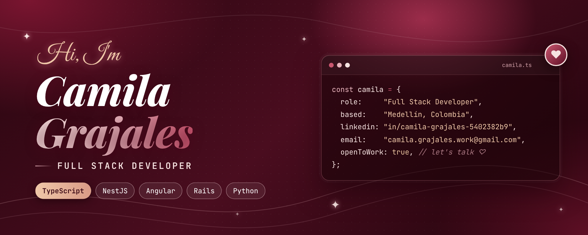

  

  <b>Full Stack Developer · TypeScript · Node.js / NestJS · Angular · Ruby on Rails · Python</b> 
  I build business software that runs in production — ERP modules, APIs and internal tools that replace spreadsheets and manual work.

  
  
  
  

### ♡ What I do

- Build and maintain **production ERP modules** (Rails + Angular): logistics, payments and reporting workflows used daily by business teams.
- Turn **manual Excel processes into reliable software** — data modeling, validations, dashboards and audit trails.
- Design **REST APIs** with NestJS and FastAPI, backed by SQL databases.
- Currently studying **Software Engineering** while working full time, and going deeper into **Go, Docker and cloud infrastructure**.

### ✦ Featured projects

| Project | What it is | Stack |
|---|---|---|
| 🚧 **[Uptime Monitor](https://github.com/camilagv1)** *(in progress)* | Self-hosted uptime monitoring with public status pages and real-time alerts | Go · NestJS · Next.js · PostgreSQL · Docker |
| **[inventory](https://github.com/camilagv1/inventory)** | Inventory management REST API | NestJS · TypeScript |
| **[PrestaTodito](https://github.com/proyectoPrestamo/FrontPrestaTodito)** | Loan management system (frontend) | JavaScript |

### ✦ Tech I use

**Backend** 

**Frontend** 

**Data** 

**Cloud & tools** 

**Learning now** 

### ✦ Let's talk

Open to **remote Full Stack / Backend roles** and collaborations.
Reach me on [LinkedIn](https://www.linkedin.com/in/camila-grajales-5402382b9) or by [email](mailto:camila.grajales.work@gmail.com).

